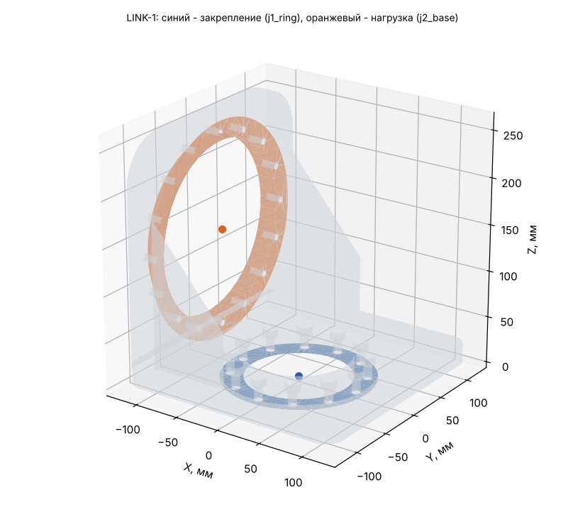

# LINK-1: исходные данные для расчёта прочности (Ansys Workbench 2024 R1)

Деталь: LINK-1-01_Weldment — геометрия `geometry/LINK-1.step` (одно тело, мм).

## Материал

AMg6: E = 69.6 ГПа, ν = 0.3, ρ = 2640 кг/м³, σ0,2 = 155 МПа, σв = 315 МПа (АМг6М листы 0,6-10,5 мм, ГОСТ 21631 (каталог ВИАМ): sigma_v >= 315, sigma_0.2 >= 155 МПа, E 69,6 ГПа, 2640 кг/м3; nu 0.30 и коэффициент прочности шва 0.9 - ПРИНЯТЫ).

Масса детали из АМг6: **4.942 кг** (в модели руки 5.055 кг при 2700 кг/м³); центр масс -39.8 / 0.0 / 63.7 мм; габарит -125 / -125 / 0 … 125 / 125 / 262 мм.

## Система координат

Глобальная СК файла STEP = СК руки в нулевой позе (рука вытянута вверх): начало на оси J1 на верхнем торце ОПУ, Z вверх по оси J1, X — в сторону колонны J3. Все силы, моменты и ускорения ниже — в этой СК, мм / Н / Н·мм. Поза руки в каждом случае своя, поэтому направление веса в СК детали меняется от случая к случаю.

## Закрепление (Fixed Support)

**j1_ring** — на внутреннем кольце ОПУ RU178G (12xM8 D139). Центр интерфейса 0.0 / 0.0 / 0.0 мм.

- плоские грани в плоскости Z = 0 мм, все вершины на расстоянии 0…80 мм от оси шарнира (ось ∥ Z через 0.0 / 0.0 / 0.0)
- площадь выбранных граней 9491 мм² (1 гр.)

Болты и швы не моделируются: грани закрепляются жёстко (болтовой стык = сплошной).

## Нагрузка (Remote Force + Moment через удалённую точку, поведение Rigid)

**j2_base** — корпус J2 (ШМ-1000, 190H7, 16xM8 D206). Удалённая точка: **-95.0 / 0.0 / 137.0 мм**.

- плоские грани в плоскости X = -95 мм, все вершины на расстоянии 95…115.8 мм от оси шарнира (ось ∥ X через -95.0 / 0.0 / 137.0)
- посадочный цилиндр R 95 мм соосно оси шарнира, по оси X в пределах -120…-70 мм
- площадь выбранных граней 25132 мм² (5 гр.)

Плюс поле ускорений самой детали (Acceleration, компоненты ниже; это ускорение тела, вес включён: при покое оно равно +9807 мм/с² «вверх» в СК детали).

## Расчётные случаи

| Случай | Сила на детали Fx / Fy / Fz, Н | Момент Mx / My / Mz, Н·м (в удалённой точке) | Ускорение детали ax / ay / az, мм/с² | Ожидаемая реакция в закреплении: F, Н; M, Н·м (в центре закрепления) | Требуемый запас / допускаемое σэкв |
|---|---|---|---|---|---|
| **S** статика: худшая поза (наибольший момент в закреплении) | -0 / 0 / -919 | -1063 / 299 / 0 | 0 / 0 / 9807 | F 0 / 0 / 968; M 1063 / -209 / -0 | 1.5 / 103 МПа (у швов ×0.9: 93) |
| **D** демо-программа: наибольший момент в закреплении | -0 / -22 / -993 | 1206 / 80 / -2 | -0 / -0 / 9807 | F 0 / 22 / 1041; M -1209 / 16 / -0 | 1.5 / 103 МПа (у швов ×0.9: 93) |
| **C** упор инструмента: приводы до пикового момента редуктора | 504 / 2713 / -1597 | -2996 / 773 / 461 | 0 / 0 / 9807 | F -504 / -2713 / 1645; M 3368 / -688 / -203 | 1 / 155 МПа (у швов ×0.9: 140) |

Позы и примечания:

- **S**: q = 0, -89.42, -176.62, -0.37, -178.44, -0.01, 85.08° — груз 8 кг + интерфейс 4 кг
- **D**: q = -0, 80.65, 0, -0, 0, 0, 0° — t = 35.87 с
- **C**: q = 0, -89.42, -176.62, -0.37, -178.44, -0.01, 85.08° — поза S, сила на инструменте 2841 Н (ограничивает J4, 1350 Н·м); сила на инструменте -504 / -2713 / 677 Н

## Как задать в Workbench вручную

1. Static Structural, материал АМг6 (свойства выше), геометрия — STEP, единицы мм.
2. Закрепление: Fixed Support на гранях закрепления.
3. Remote Point в -95.0 / 0.0 / 137.0 мм на гранях нагрузки, Behavior = Rigid.
4. На эту удалённую точку — Remote Force (компоненты) и Moment (компоненты) случая; Acceleration — компоненты случая.
5. Сетка: тетраэдры 2-го порядка, размер 5 мм (у швов и галтелей — сгустить).
6. Проверка: реакция Fixed Support (Force/Moment Reaction в центре закрепления) должна совпасть с колонкой «Ожидаемая реакция» с точностью до погрешности сетки — так видно, что нагрузки заданы верно.
7. Критерий: σэкв (Мизес) ≤ допускаемого; локальные пики на кромках закрепления — концентрация от жёсткой заделки, их не учитывать (оценивать на расстоянии 1–2 элементов от кромки).
