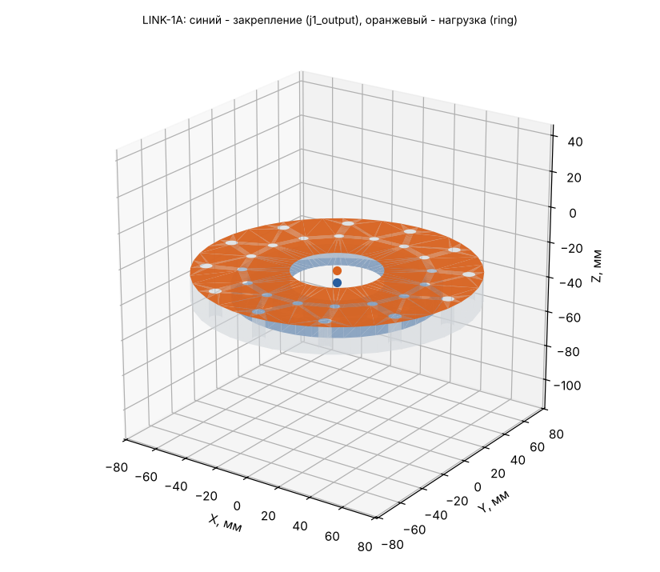

# LINK-1A: исходные данные для расчёта прочности (Ansys Workbench 2024 R1)

Деталь: LINK-1-02_J1Adapter — геометрия `geometry/LINK-1A.step` (одно тело, мм).

## Материал

AMg6: E = 69.6 ГПа, ν = 0.3, ρ = 2640 кг/м³, σ0,2 = 155 МПа, σв = 315 МПа (АМг6М листы 0,6-10,5 мм, ГОСТ 21631 (каталог ВИАМ): sigma_v >= 315, sigma_0.2 >= 155 МПа, E 69,6 ГПа, 2640 кг/м3; nu 0.30 и коэффициент прочности шва 0.9 - ПРИНЯТЫ).

Масса детали из АМг6: **0.479 кг** (в модели руки 0.489 кг при 2700 кг/м³); центр масс 0.0 / -0.0 / -34.3 мм; габарит -66 / -70 / -43 … 78 / 70 / -28 мм.

## Система координат

Глобальная СК файла STEP = СК руки в нулевой позе (рука вытянута вверх): начало на оси J1 на верхнем торце ОПУ, Z вверх по оси J1, X — в сторону колонны J3. Все силы, моменты и ускорения ниже — в этой СК, мм / Н / Н·мм. Поза руки в каждом случае своя, поэтому направление веса в СК детали меняется от случая к случаю.

## Закрепление (Fixed Support)

**j1_output** — на выходном валу J1 (ШМ-150м, 112H7, 16xM5 D100). Центр интерфейса 0.0 / 0.0 / -35.0 мм.

- плоские грани в плоскости Z = -35 мм, все вершины на расстоянии 0…56 мм от оси шарнира (ось ∥ Z через 0.0 / 0.0 / -35.0)
- посадочный цилиндр R 56 мм соосно оси шарнира, по оси Z в пределах -60…-10 мм
- площадь выбранных граней 10323 мм² (2 гр.)

Болты и швы не моделируются: грани закрепляются жёстко (болтовой стык = сплошной).

## Нагрузка (Remote Force + Moment через удалённую точку, поведение Rigid)

**ring** — под внутренним кольцом ОПУ (крутящий момент J1). Удалённая точка: **0.0 / 0.0 / -28.0 мм**.

- плоские грани в плоскости Z = -28 мм, все вершины на расстоянии 0…77.5 мм от оси шарнира (ось ∥ Z через 0.0 / 0.0 / -28.0)
- площадь выбранных граней 16090 мм² (1 гр.)

Плюс поле ускорений самой детали (Acceleration, компоненты ниже; это ускорение тела, вес включён: при покое оно равно +9807 мм/с² «вверх» в СК детали).

## Расчётные случаи

| Случай | Сила на детали Fx / Fy / Fz, Н | Момент Mx / My / Mz, Н·м (в удалённой точке) | Ускорение детали ax / ay / az, мм/с² | Ожидаемая реакция в закреплении: F, Н; M, Н·м (в центре закрепления) | Требуемый запас / допускаемое σэкв |
|---|---|---|---|---|---|
| **D** демо-программа: наибольший момент J1 | 0 / 0 / 0 | 0 / 0 / 106 | 0 / 0 / 0 | F 0 / 0 / 0; M -0 / 0 / -106 | 1.5 / 103 МПа (у швов ×0.9: 93) |
| **C** упор: J1 развивает пиковый момент редуктора 310 Н·м | 0 / 0 / 0 | 0 / 0 / -310 | 0 / 0 / 0 | F 0 / 0 / 0; M -0 / 0 / 310 | 1 / 155 МПа (у швов ×0.9: 140) |

Позы и примечания:

- **D**: q = -0, 30, -4.17, 100, 0, 40, 0° — t = 30.83 с
- **C**: q = 0, 90, 0, 0, 0, 0, 0° — рука горизонтально, сила на инструменте 109 Н; сила на инструменте 109 / 2 / -0 Н

## Выходной подшипник редуктора J1 (DMRD-KB32)

Реакция в закреплении = нагрузка на выходной вал J1. Каталог: опрокидывающий момент M_tilt = 336 Н·м, осевая сила F_axial = 11500 Н.

| Случай | Крутящий, Н·м | Опрокидывающий, Н·м | % M_tilt | Осевая сила, Н |
|---|---|---|---|---|
| D | 106 | 0 | 0 % | 0 |
| C | 310 | 0 | 0 % | 0 |

## Как задать в Workbench вручную

1. Static Structural, материал АМг6 (свойства выше), геометрия — STEP, единицы мм.
2. Закрепление: Fixed Support на гранях закрепления.
3. Remote Point в 0.0 / 0.0 / -28.0 мм на гранях нагрузки, Behavior = Rigid.
4. На эту удалённую точку — Remote Force (компоненты) и Moment (компоненты) случая; Acceleration — компоненты случая.
5. Сетка: тетраэдры 2-го порядка, размер 3 мм (у швов и галтелей — сгустить).
6. Проверка: реакция Fixed Support (Force/Moment Reaction в центре закрепления) должна совпасть с колонкой «Ожидаемая реакция» с точностью до погрешности сетки — так видно, что нагрузки заданы верно.
7. Критерий: σэкв (Мизес) ≤ допускаемого; локальные пики на кромках закрепления — концентрация от жёсткой заделки, их не учитывать (оценивать на расстоянии 1–2 элементов от кромки).
