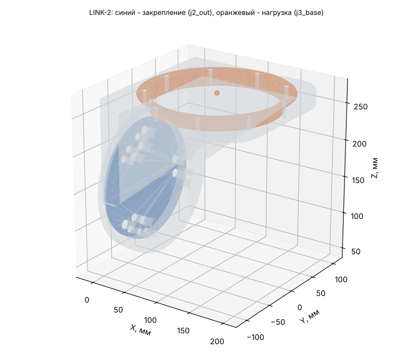

# LINK-2: исходные данные для расчёта прочности (Ansys Workbench 2024 R1)

Деталь: LINK-2-01_Weldment — геометрия `geometry/LINK-2.step` (одно тело, мм).

## Материал

AMg6: E = 69.6 ГПа, ν = 0.3, ρ = 2640 кг/м³, σ0,2 = 155 МПа, σв = 315 МПа (АМг6М листы 0,6-10,5 мм, ГОСТ 21631 (каталог ВИАМ): sigma_v >= 315, sigma_0.2 >= 155 МПа, E 69,6 ГПа, 2640 кг/м3; nu 0.30 и коэффициент прочности шва 0.9 - ПРИНЯТЫ).

Масса детали из АМг6: **3.574 кг** (в модели руки 3.655 кг при 2700 кг/м³); центр масс 39.1 / 0.0 / 193.8 мм; габарит -13 / -100 / 71 … 205 / 100 / 276 мм.

## Система координат

Глобальная СК файла STEP = СК руки в нулевой позе (рука вытянута вверх): начало на оси J1 на верхнем торце ОПУ, Z вверх по оси J1, X — в сторону колонны J3. Все силы, моменты и ускорения ниже — в этой СК, мм / Н / Н·мм. Поза руки в каждом случае своя, поэтому направление веса в СК детали меняется от случая к случаю.

## Закрепление (Fixed Support)

**j2_out** — на выходном валу J2 (ШМ-1000, 160H7, 9xM8 D142 + 6xM10 D110). Центр интерфейса 0.0 / 0.0 / 137.0 мм.

- плоские грани в плоскости X = 0 мм, все вершины на расстоянии 0…80 мм от оси шарнира (ось ∥ X через 0.0 / 0.0 / 137.0)
- посадочный цилиндр R 80 мм соосно оси шарнира, по оси X в пределах -25…25 мм
- площадь выбранных граней 25159 мм² (3 гр.)

Болты и швы не моделируются: грани закрепляются жёстко (болтовой стык = сплошной).

## Нагрузка (Remote Force + Moment через удалённую точку, поведение Rigid)

**j3_base** — корпус J3 (ШМ-500, 168H7, 9xM6 D180). Удалённая точка: **105.0 / 0.0 / 276.0 мм**.

- плоские грани в плоскости Z = 276 мм, все вершины на расстоянии 84…99.6 мм от оси шарнира (ось ∥ Z через 105.0 / 0.0 / 276.0)
- посадочный цилиндр R 84 мм соосно оси шарнира, по оси Z в пределах 251…301 мм
- площадь выбранных граней 19377 мм² (3 гр.)

Плюс поле ускорений самой детали (Acceleration, компоненты ниже; это ускорение тела, вес включён: при покое оно равно +9807 мм/с² «вверх» в СК детали).

## Расчётные случаи

| Случай | Сила на детали Fx / Fy / Fz, Н | Момент Mx / My / Mz, Н·м (в удалённой точке) | Ускорение детали ax / ay / az, мм/с² | Ожидаемая реакция в закреплении: F, Н; M, Н·м (в центре закрепления) | Требуемый запас / допускаемое σэкв |
|---|---|---|---|---|---|
| **S** статика: худшая поза (наибольший момент в закреплении) | -0 / -701 / 3 | 964 / -1 / -153 | 0 / 9807 / -43 | F 0 / 737 / -3; M -1063 / 1 / 228 | 1.5 / 103 МПа (у швов ×0.9: 93) |
| **D** демо-программа: наибольший момент в закреплении | -0 / -768 / -104 | 1097 / -10 / 80 | 0 / 9716 / 1588 | F 0 / 803 / 110; M -1206 / -1 / 2 | 1.5 / 103 МПа (у швов ×0.9: 93) |
| **C** упор инструмента: приводы до пикового момента редуктора | 81 / -1380 / 870 | 2807 / -214 / -492 | 0 / 9807 / -43 | F -81 / 1415 / -870; M -3001 / 294 / 638 | 1 / 155 МПа (у швов ×0.9: 140) |

Позы и примечания:

- **S**: q = 0, 90.25, -178.7, -0.08, -179.68, -0.05, -163.07° — груз 8 кг + интерфейс 4 кг
- **D**: q = -0, 80.65, 0, -0, 0, 0, 0° — t = 35.87 с
- **C**: q = 0, 90.25, -178.7, -0.08, -179.68, -0.05, -163.07° — поза S, сила на инструменте 1104 Н (ограничивает J4, 1350 Н·м); сила на инструменте -81 / 864 / 682 Н

## Выходной подшипник редуктора J2 (DMRD-80E)

Реакция в закреплении = нагрузка на выходной вал J2. Каталог: опрокидывающий момент M_tilt = 2156 Н·м, осевая сила F_axial = ? Н.

| Случай | Крутящий, Н·м | Опрокидывающий, Н·м | % M_tilt | Осевая сила, Н |
|---|---|---|---|---|
| S | 1063 | 228 | 11 % | 0 |
| D | 1206 | 3 | 0 % | 0 |
| C | 3001 | 703 | 33 % | 81 |

## Как задать в Workbench вручную

1. Static Structural, материал АМг6 (свойства выше), геометрия — STEP, единицы мм.
2. Закрепление: Fixed Support на гранях закрепления.
3. Remote Point в 105.0 / 0.0 / 276.0 мм на гранях нагрузки, Behavior = Rigid.
4. На эту удалённую точку — Remote Force (компоненты) и Moment (компоненты) случая; Acceleration — компоненты случая.
5. Сетка: тетраэдры 2-го порядка, размер 5 мм (у швов и галтелей — сгустить).
6. Проверка: реакция Fixed Support (Force/Moment Reaction в центре закрепления) должна совпасть с колонкой «Ожидаемая реакция» с точностью до погрешности сетки — так видно, что нагрузки заданы верно.
7. Критерий: σэкв (Мизес) ≤ допускаемого; локальные пики на кромках закрепления — концентрация от жёсткой заделки, их не учитывать (оценивать на расстоянии 1–2 элементов от кромки).
