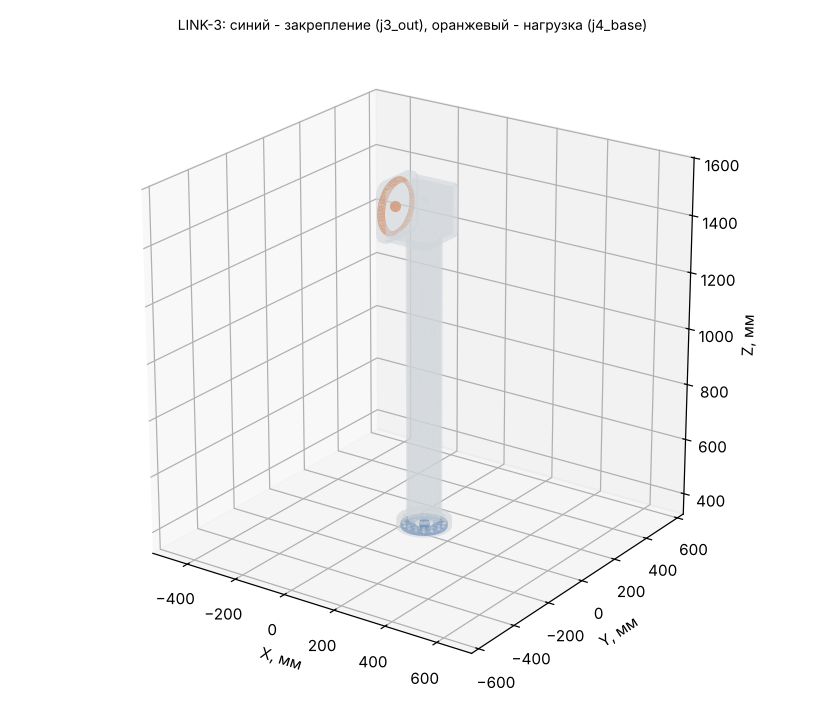

# LINK-3: исходные данные для расчёта прочности (Ansys Workbench 2024 R1)

Деталь: LINK-3-01_Weldment — геометрия `geometry/LINK-3.step` (одно тело, мм).

## Материал

AMg6: E = 69.6 ГПа, ν = 0.3, ρ = 2640 кг/м³, σ0,2 = 155 МПа, σв = 315 МПа (АМг6М листы 0,6-10,5 мм, ГОСТ 21631 (каталог ВИАМ): sigma_v >= 315, sigma_0.2 >= 155 МПа, E 69,6 ГПа, 2640 кг/м3; nu 0.30 и коэффициент прочности шва 0.9 - ПРИНЯТЫ).

Масса детали из АМг6: **10.641 кг** (в модели руки 10.883 кг при 2700 кг/м³); центр масс 94.8 / 0.0 / 1061.3 мм; габарит -11 / -105 / 355 … 198 / 105 / 1572 мм.

## Система координат

Глобальная СК файла STEP = СК руки в нулевой позе (рука вытянута вверх): начало на оси J1 на верхнем торце ОПУ, Z вверх по оси J1, X — в сторону колонны J3. Все силы, моменты и ускорения ниже — в этой СК, мм / Н / Н·мм. Поза руки в каждом случае своя, поэтому направление веса в СК детали меняется от случая к случаю.

## Закрепление (Fixed Support)

**j3_out** — на выходном валу J3 (ШМ-500, 158H7, 16xM8 D140). Центр интерфейса 105.0 / 0.0 / 365.0 мм.

- плоские грани в плоскости Z = 365 мм, все вершины на расстоянии 0…79 мм от оси шарнира (ось ∥ Z через 105.0 / 0.0 / 365.0)
- посадочный цилиндр R 79 мм соосно оси шарнира, по оси Z в пределах 340…390 мм
- площадь выбранных граней 20725 мм² (2 гр.)

Болты и швы не моделируются: грани закрепляются жёстко (болтовой стык = сплошной).

## Нагрузка (Remote Force + Moment через удалённую точку, поведение Rigid)

**j4_base** — корпус J4 (ШМ-500, 168H7, 9xM6 D180). Удалённая точка: **-11.0 / 0.0 / 1467.0 мм**.

- плоские грани в плоскости X = -11 мм, все вершины на расстоянии 84…99.6 мм от оси шарнира (ось ∥ X через -11.0 / 0.0 / 1467.0)
- посадочный цилиндр R 84 мм соосно оси шарнира, по оси X в пределах -36…14 мм
- площадь выбранных граней 19377 мм² (2 гр.)

Плюс поле ускорений самой детали (Acceleration, компоненты ниже; это ускорение тела, вес включён: при покое оно равно +9807 мм/с² «вверх» в СК детали).

## Расчётные случаи

| Случай | Сила на детали Fx / Fy / Fz, Н | Момент Mx / My / Mz, Н·м (в удалённой точке) | Ускорение детали ax / ay / az, мм/с² | Ожидаемая реакция в закреплении: F, Н; M, Н·м (в центре закрепления) | Требуемый запас / допускаемое σэкв |
|---|---|---|---|---|---|
| **S** статика: худшая поза (наибольший момент в закреплении) | -318 / -335 / -53 | 232 / -232 / 71 | 6708 / 7065 / 1125 | F 389 / 410 / 65; M -653 / 638 / -111 | 1.5 / 103 МПа (у швов ×0.9: 93) |
| **D** демо-программа: наибольший момент в закреплении | -0 / -526 / -67 | 377 / -2 / 17 | 0 / 10324 / 1508 | F 0 / 636 / 83; M -1033 / 10 / -79 | 1.5 / 103 МПа (у швов ×0.9: 93) |
| **C** упор инструмента: приводы до пикового момента редуктора | -809 / -1052 / -1275 | 1311 / -1440 / 346 | 6708 / 7065 / 1125 | F 880 / 1127 / 1287; M -2522 / 2529 / -469 | 1 / 155 МПа (у швов ×0.9: 140) |

Позы и примечания:

- **S**: q = 0, -83.41, -136.48, -0.4, -177.81, 0.09, 149.22° — груз 8 кг + интерфейс 4 кг
- **D**: q = -0, 80.65, 0, -0, 0, 0, 0° — t = 35.87 с
- **C**: q = 0, -83.41, -136.48, -0.4, -177.81, 0.09, 149.22° — поза S, сила на инструменте 1499 Н (ограничивает J2, 3920 Н·м); сила на инструменте 138 / 1116 / 992 Н

## Выходной подшипник редуктора J3 (DMRD-KB45)

Реакция в закреплении = нагрузка на выходной вал J3. Каталог: опрокидывающий момент M_tilt = 740 Н·м, осевая сила F_axial = 13000 Н.

| Случай | Крутящий, Н·м | Опрокидывающий, Н·м | % M_tilt | Осевая сила, Н |
|---|---|---|---|---|
| S | 111 | 915 | 124 % | 66 |
| D | 79 | 1037 | 140 % | 83 |
| C | 469 | 3573 | 483 % | 1287 |

## Как задать в Workbench вручную

1. Static Structural, материал АМг6 (свойства выше), геометрия — STEP, единицы мм.
2. Закрепление: Fixed Support на гранях закрепления.
3. Remote Point в -11.0 / 0.0 / 1467.0 мм на гранях нагрузки, Behavior = Rigid.
4. На эту удалённую точку — Remote Force (компоненты) и Moment (компоненты) случая; Acceleration — компоненты случая.
5. Сетка: тетраэдры 2-го порядка, размер 5 мм (у швов и галтелей — сгустить).
6. Проверка: реакция Fixed Support (Force/Moment Reaction в центре закрепления) должна совпасть с колонкой «Ожидаемая реакция» с точностью до погрешности сетки — так видно, что нагрузки заданы верно.
7. Критерий: σэкв (Мизес) ≤ допускаемого; локальные пики на кромках закрепления — концентрация от жёсткой заделки, их не учитывать (оценивать на расстоянии 1–2 элементов от кромки).
