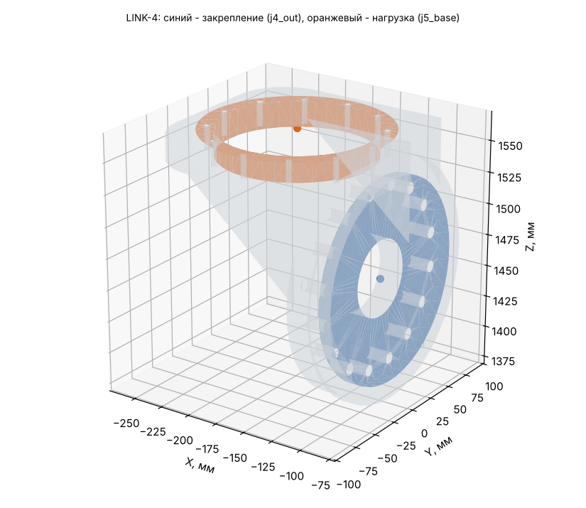

# LINK-4: исходные данные для расчёта прочности (Ansys Workbench 2024 R1)

Деталь: LINK-4-01_Weldment — геометрия `geometry/LINK-4.step` (одно тело, мм).

## Материал

AMg6: E = 69.6 ГПа, ν = 0.3, ρ = 2640 кг/м³, σ0,2 = 155 МПа, σв = 315 МПа (АМг6М листы 0,6-10,5 мм, ГОСТ 21631 (каталог ВИАМ): sigma_v >= 315, sigma_0.2 >= 155 МПа, E 69,6 ГПа, 2640 кг/м3; nu 0.30 и коэффициент прочности шва 0.9 - ПРИНЯТЫ).

Масса детали из АМг6: **2.221 кг** (в модели руки 2.272 кг при 2700 кг/м³); центр масс -131.4 / -0.0 / 1499.2 мм; габарит -254 / -80 / 1403 … -90 / 80 / 1568 мм.

## Система координат

Глобальная СК файла STEP = СК руки в нулевой позе (рука вытянута вверх): начало на оси J1 на верхнем торце ОПУ, Z вверх по оси J1, X — в сторону колонны J3. Все силы, моменты и ускорения ниже — в этой СК, мм / Н / Н·мм. Поза руки в каждом случае своя, поэтому направление веса в СК детали меняется от случая к случаю.

## Закрепление (Fixed Support)

**j4_out** — на выходном валу J4 (ШМ-500, 158H7, 16xM8 D140). Центр интерфейса -100.0 / 0.0 / 1467.0 мм.

- плоские грани в плоскости X = -100 мм, все вершины на расстоянии 0…79 мм от оси шарнира (ось ∥ X через -100.0 / 0.0 / 1467.0)
- посадочный цилиндр R 79 мм соосно оси шарнира, по оси X в пределах -125…-75 мм
- площадь выбранных граней 20725 мм² (3 гр.)

Болты и швы не моделируются: грани закрепляются жёстко (болтовой стык = сплошной).

## Нагрузка (Remote Force + Moment через удалённую точку, поведение Rigid)

**j5_base** — корпус J5 (ШМ-150, 122H7, 12xM5 D132). Удалённая точка: **-174.0 / 0.0 / 1568.0 мм**.

- плоские грани в плоскости Z = 1568 мм, все вершины на расстоянии 61…74 мм от оси шарнира (ось ∥ Z через -174.0 / 0.0 / 1568.0)
- посадочный цилиндр R 61 мм соосно оси шарнира, по оси Z в пределах 1543…1593 мм
- площадь выбранных граней 13072 мм² (3 гр.)

Плюс поле ускорений самой детали (Acceleration, компоненты ниже; это ускорение тела, вес включён: при покое оно равно +9807 мм/с² «вверх» в СК детали).

## Расчётные случаи

| Случай | Сила на детали Fx / Fy / Fz, Н | Момент Mx / My / Mz, Н·м (в удалённой точке) | Ускорение детали ax / ay / az, мм/с² | Ожидаемая реакция в закреплении: F, Н; M, Н·м (в центре закрепления) | Требуемый запас / допускаемое σэкв |
|---|---|---|---|---|---|
| **S** статика: худшая поза (наибольший момент в закреплении) | 291 / 102 / 59 | -94 / 276 / -13 | -9093 / -3183 / -1832 | F -311 / -109 / -63; M 105 / -311 / 21 | 1.5 / 103 МПа (у швов ×0.9: 93) |
| **D** демо-программа: наибольший момент в закреплении | -0 / -362 / -44 | 340 / 6 / -48 | 0 / 10630 / 1467 | F 0 / 386 / 47; M -377 / -2 / 21 | 1.5 / 103 МПа (у швов ×0.9: 93) |
| **C** упор инструмента: приводы до пикового момента редуктора | 1083 / 926 / -587 | -1256 / 1252 / -194 | -9093 / -3183 / -1832 | F -1104 / -933 / 583; M 1350 / -1319 / 263 | 1 / 155 МПа (у швов ×0.9: 140) |

Позы и примечания:

- **S**: q = 0, -72.94, 75.9, -81.48, -180, -0.03, -32.84° — груз 8 кг + интерфейс 4 кг
- **D**: q = -0, 80.65, 0, -0, 0, 0, 0° — t = 35.87 с
- **C**: q = 0, -72.94, 75.9, -81.48, -180, -0.03, -32.84° — поза S, сила на инструменте 1313 Н (ограничивает J4, 1350 Н·м); сила на инструменте -694 / 682 / 882 Н

## Выходной подшипник редуктора J4 (DMRD-KB45)

Реакция в закреплении = нагрузка на выходной вал J4. Каталог: опрокидывающий момент M_tilt = 740 Н·м, осевая сила F_axial = 13000 Н.

| Случай | Крутящий, Н·м | Опрокидывающий, Н·м | % M_tilt | Осевая сила, Н |
|---|---|---|---|---|
| S | 105 | 311 | 42 % | 311 |
| D | 377 | 21 | 3 % | 0 |
| C | 1350 | 1345 | 182 % | 1104 |

## Как задать в Workbench вручную

1. Static Structural, материал АМг6 (свойства выше), геометрия — STEP, единицы мм.
2. Закрепление: Fixed Support на гранях закрепления.
3. Remote Point в -174.0 / 0.0 / 1568.0 мм на гранях нагрузки, Behavior = Rigid.
4. На эту удалённую точку — Remote Force (компоненты) и Moment (компоненты) случая; Acceleration — компоненты случая.
5. Сетка: тетраэдры 2-го порядка, размер 4 мм (у швов и галтелей — сгустить).
6. Проверка: реакция Fixed Support (Force/Moment Reaction в центре закрепления) должна совпасть с колонкой «Ожидаемая реакция» с точностью до погрешности сетки — так видно, что нагрузки заданы верно.
7. Критерий: σэкв (Мизес) ≤ допускаемого; локальные пики на кромках закрепления — концентрация от жёсткой заделки, их не учитывать (оценивать на расстоянии 1–2 элементов от кромки).
