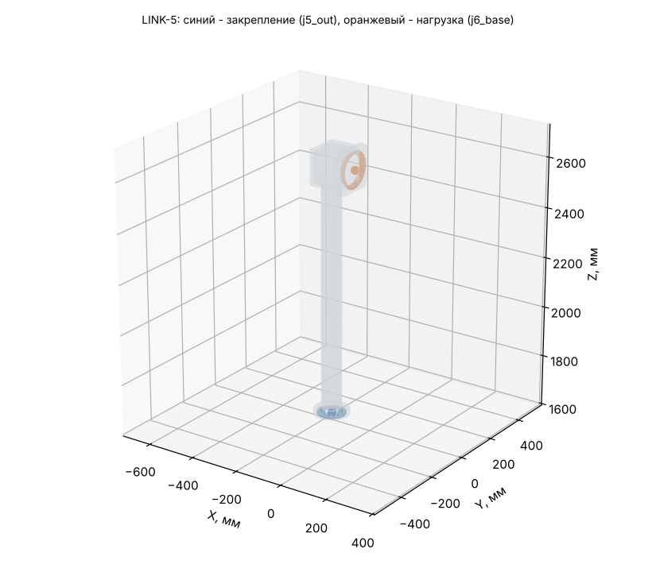

# LINK-5: исходные данные для расчёта прочности (Ansys Workbench 2024 R1)

Деталь: LINK-5-01_Weldment — геометрия `geometry/LINK-5.step` (одно тело, мм).

## Материал

AMg6: E = 69.6 ГПа, ν = 0.3, ρ = 2640 кг/м³, σ0,2 = 155 МПа, σв = 315 МПа (АМг6М листы 0,6-10,5 мм, ГОСТ 21631 (каталог ВИАМ): sigma_v >= 315, sigma_0.2 >= 155 МПа, E 69,6 ГПа, 2640 кг/м3; nu 0.30 и коэффициент прочности шва 0.9 - ПРИНЯТЫ).

Масса детали из АМг6: **5.423 кг** (в модели руки 5.546 кг при 2700 кг/м³); центр масс -157.8 / -0.0 / 2288.2 мм; габарит -222 / -85 / 1620 … -73 / 85 / 2702 мм.

## Система координат

Глобальная СК файла STEP = СК руки в нулевой позе (рука вытянута вверх): начало на оси J1 на верхнем торце ОПУ, Z вверх по оси J1, X — в сторону колонны J3. Все силы, моменты и ускорения ниже — в этой СК, мм / Н / Н·мм. Поза руки в каждом случае своя, поэтому направление веса в СК детали меняется от случая к случаю.

## Закрепление (Fixed Support)

**j5_out** — на выходном валу J5 (ШМ-150, 112H7, 16xM5 D100). Центр интерфейса -174.0 / 0.0 / 1626.5 мм.

- плоские грани в плоскости Z = 1626.5 мм, все вершины на расстоянии 0…56 мм от оси шарнира (ось ∥ Z через -174.0 / 0.0 / 1626.5)
- посадочный цилиндр R 56 мм соосно оси шарнира, по оси Z в пределах 1601.5…1651.5 мм
- площадь выбранных граней 9620 мм² (2 гр.)

Болты и швы не моделируются: грани закрепляются жёстко (болтовой стык = сплошной).

## Нагрузка (Remote Force + Moment через удалённую точку, поведение Rigid)

**j6_base** — корпус J6 (ШМ-150, 122H7, 12xM5 D132). Удалённая точка: **-73.0 / 0.0 / 2617.0 мм**.

- плоские грани в плоскости X = -73 мм, все вершины на расстоянии 61…74 мм от оси шарнира (ось ∥ X через -73.0 / 0.0 / 2617.0)
- посадочный цилиндр R 61 мм соосно оси шарнира, по оси X в пределах -98…-48 мм
- площадь выбранных граней 13013 мм² (2 гр.)

Плюс поле ускорений самой детали (Acceleration, компоненты ниже; это ускорение тела, вес включён: при покое оно равно +9807 мм/с² «вверх» в СК детали).

## Расчётные случаи

| Случай | Сила на детали Fx / Fy / Fz, Н | Момент Mx / My / Mz, Н·м (в удалённой точке) | Ускорение детали ax / ay / az, мм/с² | Ожидаемая реакция в закреплении: F, Н; M, Н·м (в центре закрепления) | Требуемый запас / допускаемое σэкв |
|---|---|---|---|---|---|
| **S** статика: худшая поза (наибольший момент в закреплении) | -7 / 208 / 1 | -31 / -1 / 19 | 343 / -9800 / -47 | F 9 / -261 / -1; M 273 / 10 / -41 | 1.5 / 103 МПа (у швов ×0.9: 93) |
| **D** демо-программа: наибольший момент в закреплении | -0 / -245 / -29 | 37 / 3 / -22 | 0 / 11183 / 1395 | F 0 / 305 / 36; M -320 / -6 / 48 | 1.5 / 103 МПа (у швов ×0.9: 93) |
| **C** упор инструмента: приводы до пикового момента редуктора | -998 / 982 / 954 | -310 / -472 / 111 | 343 / -9800 / -47 | F 1000 / -1035 / -954; M 1318 / 1558 / -211 | 1 / 155 МПа (у швов ×0.9: 140) |

Позы и примечания:

- **S**: q = 0, -86.37, 79.34, 162.48, -103.25, -0.13, 9.04° — груз 8 кг + интерфейс 4 кг
- **D**: q = -0, 80.65, 0, -0, 0, 0, 0° — t = 35.87 с
- **C**: q = 0, -86.37, 79.34, 162.48, -103.25, -0.13, 9.04° — поза S, сила на инструменте 1578 Н (ограничивает J6, 310 Н·м); сила на инструменте -1201 / 622 / 812 Н

## Выходной подшипник редуктора J5 (DMRD-KB32)

Реакция в закреплении = нагрузка на выходной вал J5. Каталог: опрокидывающий момент M_tilt = 336 Н·м, осевая сила F_axial = 11500 Н.

| Случай | Крутящий, Н·м | Опрокидывающий, Н·м | % M_tilt | Осевая сила, Н |
|---|---|---|---|---|
| S | 41 | 274 | 81 % | 1 |
| D | 48 | 321 | 96 % | 36 |
| C | 212 | 2041 | 607 % | 954 |

## Как задать в Workbench вручную

1. Static Structural, материал АМг6 (свойства выше), геометрия — STEP, единицы мм.
2. Закрепление: Fixed Support на гранях закрепления.
3. Remote Point в -73.0 / 0.0 / 2617.0 мм на гранях нагрузки, Behavior = Rigid.
4. На эту удалённую точку — Remote Force (компоненты) и Moment (компоненты) случая; Acceleration — компоненты случая.
5. Сетка: тетраэдры 2-го порядка, размер 4 мм (у швов и галтелей — сгустить).
6. Проверка: реакция Fixed Support (Force/Moment Reaction в центре закрепления) должна совпасть с колонкой «Ожидаемая реакция» с точностью до погрешности сетки — так видно, что нагрузки заданы верно.
7. Критерий: σэкв (Мизес) ≤ допускаемого; локальные пики на кромках закрепления — концентрация от жёсткой заделки, их не учитывать (оценивать на расстоянии 1–2 элементов от кромки).
