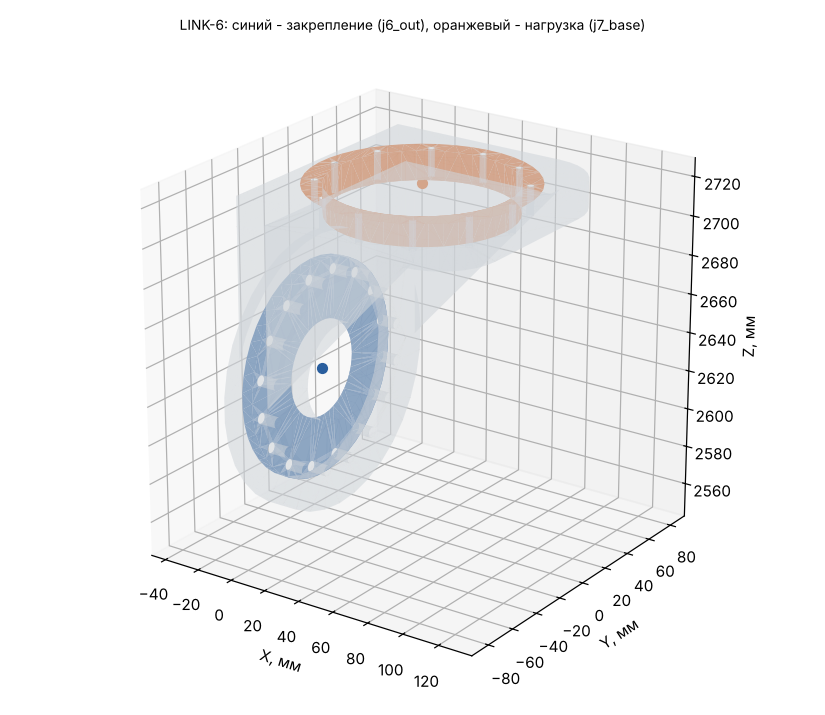

# LINK-6: исходные данные для расчёта прочности (Ansys Workbench 2024 R1)

Деталь: LINK-6-01_Weldment — геометрия `geometry/LINK-6.step` (одно тело, мм).

## Материал

AMg6: E = 69.6 ГПа, ν = 0.3, ρ = 2640 кг/м³, σ0,2 = 155 МПа, σв = 315 МПа (АМг6М листы 0,6-10,5 мм, ГОСТ 21631 (каталог ВИАМ): sigma_v >= 315, sigma_0.2 >= 155 МПа, E 69,6 ГПа, 2640 кг/м3; nu 0.30 и коэффициент прочности шва 0.9 - ПРИНЯТЫ).

Масса детали из АМг6: **1.069 кг** (в модели руки 1.093 кг при 2700 кг/м³); центр масс 13.7 / 0.0 / 2667.8 мм; габарит -20 / -65 / 2571 … 110 / 65 / 2725 мм.

## Система координат

Глобальная СК файла STEP = СК руки в нулевой позе (рука вытянута вверх): начало на оси J1 на верхнем торце ОПУ, Z вверх по оси J1, X — в сторону колонны J3. Все силы, моменты и ускорения ниже — в этой СК, мм / Н / Н·мм. Поза руки в каждом случае своя, поэтому направление веса в СК детали меняется от случая к случаю.

## Закрепление (Fixed Support)

**j6_out** — на выходном валу J6 (ШМ-150, 112H7, 16xM5 D100). Центр интерфейса -14.5 / 0.0 / 2617.0 мм.

- плоские грани в плоскости X = -14.5 мм, все вершины на расстоянии 0…56 мм от оси шарнира (ось ∥ X через -14.5 / 0.0 / 2617.0)
- посадочный цилиндр R 56 мм соосно оси шарнира, по оси X в пределах -39.5…10.5 мм
- площадь выбранных граней 9620 мм² (3 гр.)

Болты и швы не моделируются: грани закрепляются жёстко (болтовой стык = сплошной).

## Нагрузка (Remote Force + Moment через удалённую точку, поведение Rigid)

**j7_base** — корпус J7 (ШМ-60, 94H7, 12xM4 D102). Удалённая точка: **45.5 / 0.0 / 2725.0 мм**.

- плоские грани в плоскости Z = 2725 мм, все вершины на расстоянии 47…57.4 мм от оси шарнира (ось ∥ Z через 45.5 / 0.0 / 2725.0)
- посадочный цилиндр R 47 мм соосно оси шарнира, по оси Z в пределах 2700…2750 мм
- площадь выбранных граней 7738 мм² (3 гр.)

Плюс поле ускорений самой детали (Acceleration, компоненты ниже; это ускорение тела, вес включён: при покое оно равно +9807 мм/с² «вверх» в СК детали).

## Расчётные случаи

| Случай | Сила на детали Fx / Fy / Fz, Н | Момент Mx / My / Mz, Н·м (в удалённой точке) | Ускорение детали ax / ay / az, мм/с² | Ожидаемая реакция в закреплении: F, Н; M, Н·м (в центре закрепления) | Требуемый запас / допускаемое σэкв |
|---|---|---|---|---|---|
| **S** статика: худшая поза (наибольший момент в закреплении) | 136 / -40 / -39 | 4 / 14 / 0 | -9072 / 2642 / 2624 | F -145 / 42 / 42; M -8 / -32 / 2 | 1.5 / 103 МПа (у швов ×0.9: 93) |
| **D** демо-программа: наибольший момент в закреплении | -0 / -173 / -20 | 18 / 0 / 0 | 0 / 11449 / 1360 | F 0 / 185 / 22; M -37 / -1 / 11 | 1.5 / 103 МПа (у швов ×0.9: 93) |
| **C** упор инструмента: приводы до пикового момента редуктора | -1744 / 843 / -15 | -219 / -461 / 0 | -9072 / 2642 / 2624 | F 1734 / -840 / 17; M 310 / 648 / -50 | 1 / 155 МПа (у швов ×0.9: 140) |

Позы и примечания:

- **S**: q = 0, -10.27, -24.9, 121.68, -95.94, -137.94, 8.88° — груз 8 кг + интерфейс 4 кг
- **D**: q = -0, 80.65, 0, -0, 0, 0, 0° — t = 35.87 с
- **C**: q = 0, -10.27, -24.9, 121.68, -95.94, -137.94, 8.88° — поза S, сила на инструменте 2076 Н (ограничивает J6, 310 Н·м); сила на инструменте 609 / -89 / -1983 Н

## Выходной подшипник редуктора J6 (DMRD-KB32)

Реакция в закреплении = нагрузка на выходной вал J6. Каталог: опрокидывающий момент M_tilt = 336 Н·м, осевая сила F_axial = 11500 Н.

| Случай | Крутящий, Н·м | Опрокидывающий, Н·м | % M_tilt | Осевая сила, Н |
|---|---|---|---|---|
| S | 8 | 32 | 9 % | 146 |
| D | 37 | 11 | 3 % | 0 |
| C | 310 | 650 | 194 % | 1734 |

## Как задать в Workbench вручную

1. Static Structural, материал АМг6 (свойства выше), геометрия — STEP, единицы мм.
2. Закрепление: Fixed Support на гранях закрепления.
3. Remote Point в 45.5 / 0.0 / 2725.0 мм на гранях нагрузки, Behavior = Rigid.
4. На эту удалённую точку — Remote Force (компоненты) и Moment (компоненты) случая; Acceleration — компоненты случая.
5. Сетка: тетраэдры 2-го порядка, размер 3 мм (у швов и галтелей — сгустить).
6. Проверка: реакция Fixed Support (Force/Moment Reaction в центре закрепления) должна совпасть с колонкой «Ожидаемая реакция» с точностью до погрешности сетки — так видно, что нагрузки заданы верно.
7. Критерий: σэкв (Мизес) ≤ допускаемого; локальные пики на кромках закрепления — концентрация от жёсткой заделки, их не учитывать (оценивать на расстоянии 1–2 элементов от кромки).
